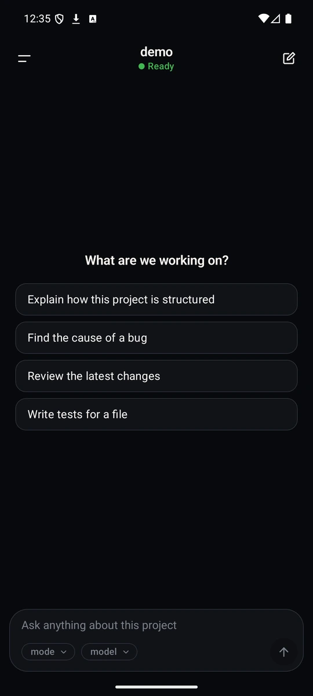
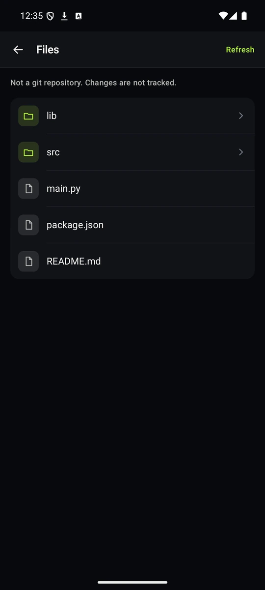
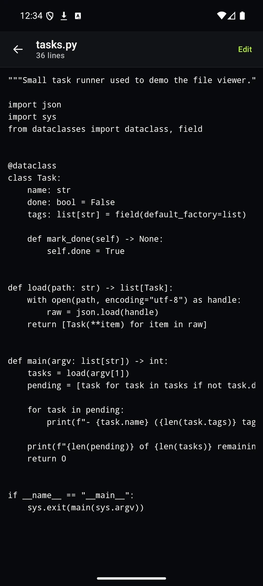
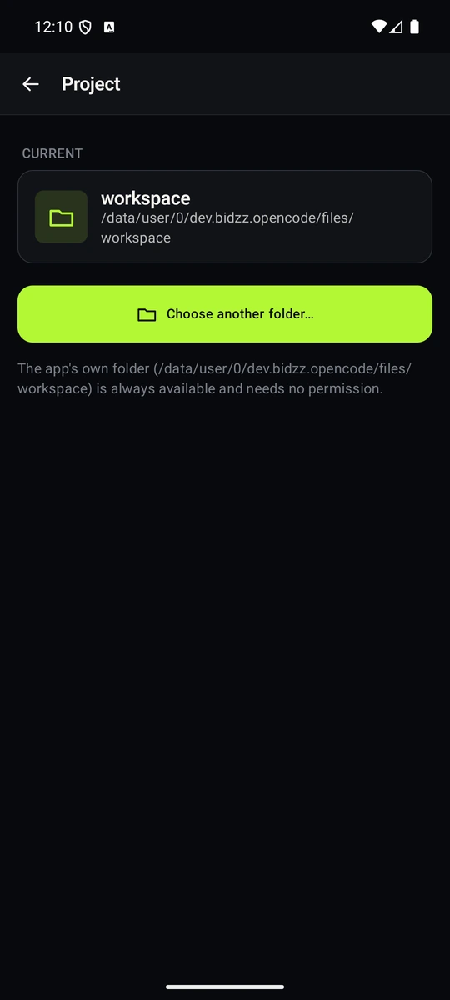
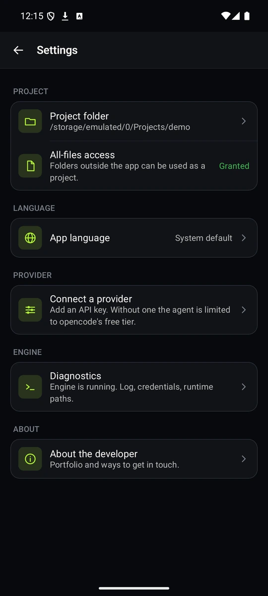
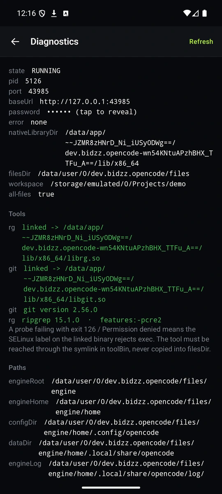

<div align="center">


# OpenCode Android

**The real [OpenCode](https://github.com/anomalyco/opencode) AI coding agent, running on your phone.**<br/>
Not a remote control. Not a WebView. Not a chatbot mockup.

[](https://github.com/hanzvibes/opencode-android/actions/workflows/ci.yml)
[](https://github.com/hanzvibes/opencode-android/releases)
[](LICENSE)


[Download](https://github.com/hanzvibes/opencode-android/releases) ·
[Features](#features) ·
[How it works](#how-it-works) ·
[Build](#building-from-source) ·
[Bahasa Indonesia](#bahasa-indonesia)

</div>

> **Independent project.** Not built, endorsed, or supported by the OpenCode team.
> "OpenCode" is used descriptively to identify the upstream project this port is based on.

---

## What is this?

OpenCode is an open source AI coding agent: you describe a task, it reads your project, runs
tools, edits files, and reports back. This project runs **the actual upstream engine** (the
TypeScript/Bun server) as a child process inside the Android app, and wraps it in a native
Jetpack Compose interface.

Everything happens on the device. Your code stays in your project folder, the engine listens only
on `127.0.0.1`, and the only network traffic is the call to the model provider **you** configure.

## Features

| | |
|---|---|
| **Chat that streams** | Replies appear token by token, with Markdown, tables, and code blocks you can copy. Edit a sent message and re-send it, quote a reply, and see tokens, cost and duration under each turn. |
| **See what the agent does** | Tool calls show as a readable timeline ("Reading index.html"), live while it runs and in history afterwards, with failures marked, durations on every step, and real diffs (+n −m) for file edits. |
| **You stay in control** | Permission prompts arrive in the chat: *Allow once*, *Always*, or *Reject* — or *Answer later* to decide when you're ready. Risky operations are flagged by risk class. Saved “Always” permissions can be listed and revoked in Settings. |
| **Attach files** | `@`-mention any file in the workspace, or browse device files outside it: text files are inlined into your message (64 KB cap). Anything else is refused with a clear message, never silently dropped. |
| **Bring your own provider** | Add an API key for a built-in provider, or define a custom OpenAI-compatible endpoint from inside the app. Replace or delete keys at any time. |
| **Modes, models, commands** | Switch mode, model and agent from the composer — with search, provider grouping and recents — and use `/` commands with autocomplete, with skills in the same palette, plus `@` file mentions. |
| **Real project folders** | Point the app at any folder on shared storage; the agent works on real POSIX paths. Switch projects and the engine restarts for you. |
| **Files and diffs** | Browse the project, read and edit files with syntax highlighting, quick-open and find-in-file, and review real `git` diffs with A/M/D badges. |
| **Search that works** | `git` and `ripgrep` are bundled, so the agent's `grep` and `glob` tools function. |
| **Agent runtime guide** | Every project gets an `AGENTS.md` seeded into the workspace on first launch, so the agent knows the bundled tools (Node, npm, xz, tar, curl) and their limits. Your edits are never overwritten. |
| **Session history** | Reopen any past conversation, for this project or all of them, with previews and transcript search. Each row shows its cost and token usage. |
| **MCP servers** | See the engine's configured MCP servers and their connection status in Settings. Connecting, disconnecting, adding and removing are not available yet. |
| **Plugins** | See the engine's enabled server plugins and their status in Settings. Checking for updates and updating are not available yet. |
| **Worktrees** | See the engine's saved worktrees grouped by project in Settings. Creating, removing and refreshing are not available yet. |
| **Engine config** | See the engine's configuration documents and their key settings in Settings. Editing config from the app is not available yet. |
| **Session inbox** | See a session's queued work — prompts, notes, compactions and moves — from its action menu. Cancelling an item and changing its delivery are not available yet. |
| **Move session** | Move a session to another project from its action menu; its history is kept. |
| **Session stats** | Aggregate session activity, usage and tool reliability in Settings. |
| **Export session** | Copy a session's complete transcript as verbatim JSON from its action menu. Import is not available yet. |
| **Usage limits** | OpenCode Go allowance meters and Console budgets in Settings. Workspaces that are not signed in to Console show an empty state. |
| **Session instructions** | Attach, edit and remove per-session instruction entries from a session's action menu. Values over 256 KB are refused with a friendly message. |
| **First-run onboarding** | A three-step first run — project, provider, permissions — and a sample project you can seed to try the agent on. |
| **Tablet layout** | On wide screens (≥840dp) the session list stays visible beside the chat, with list-detail navigation; content caps at 720dp everywhere else. |
| **Survives the swipe** | A foreground service keeps the engine alive when you leave the app or swipe it from recents. |
| **Two languages, three themes** | English and Indonesian, switchable at runtime without leaving the screen. System, dark and light themes, with bundled Inter and JetBrains Mono type. |
| **Built-in diagnostics** | Engine state, a searchable log viewer with follow mode, runtime paths, and `git`/`rg` self-checks, so release builds can be debugged without `adb`. Restart the engine from here. |
| **In-app browser** | Links from chat open in a browser inside the app (system WebView, no bundled Chromium): back/forward, reload, share, open outside, downloads to the Downloads folder. `mailto:`/`tel:` still go to the system. |
| **Share in and out** | Share an answer to any app, or share text/a link from any app into a fresh draft. Sessions open from `opencode://session/<id>` links, launcher shortcuts (new session + last session) and a home-screen widget. |
| **Done notifications** | When an agent run finishes while the app is in the background, a notification says so; tapping it opens the session. |
| **Camera photos** | Take a photo from the composer: it is saved into the project (`.opencode-photos/`) and mentioned in the draft by path, so the agent can reference it. |
| **App lock** | Lock the app behind biometrics or your device PIN, from Settings → Security. The lock re-arms when the app returns from the background; the engine keeps running behind it. |
| **File previews** | Images and PDFs open as previews inside the file viewer — sampled image decode and a page-by-page PDF renderer — instead of failing the text load. |
| **Drag & drop** | Long-press a file in the Explorer and drop it on the composer to mention it by path; drop a file from another app onto the composer to attach it as text (same 64 KB rules as the file picker). |
| **Multi-window** | The app declares split-screen/freeform resize support; the adaptive layout (persistent sidebar ≥840dp, drawer below) already follows the window width. |

### Not yet

An interactive terminal, LSP, session fork/revert, and `git` over https
(`clone`/`push`/`fetch`). See [`docs/BUILD.md`](docs/BUILD.md#known-gaps) for the
current list of known build gaps.

### Known limitations

- **Editing a message re-sends it as a new message** — the original stays visible. Truly
  truncating the turn and re-running needs a verified engine API, which the app does not
  have yet.
- **Session previews load full history**, so opening the session list can be slow on long
  sessions.

## Screenshots

<table>
  <tr>
    <td align="center"><br/><sub><b>Chat</b> — one composer, model and mode in reach</sub></td>
    <td align="center"><br/><sub><b>Files</b> — the real project tree, folders first</sub></td>
  </tr>
  <tr>
    <td align="center"><br/><sub><b>Source</b> — read files with syntax highlighting</sub></td>
    <td align="center"><br/><sub><b>Project</b> — any folder, recent ones remembered</sub></td>
  </tr>
  <tr>
    <td align="center"><br/><sub><b>Settings</b> — project, language, provider, engine</sub></td>
    <td align="center"><br/><sub><b>Diagnostics</b> — state, <code>git</code>/<code>rg</code> checks, paths</sub></td>
  </tr>
</table>

Captured from the app running on a device, dark theme. A conversation screenshot is deliberately
missing: every screen above needs no API key, and a transcript would have to be staged to look real.
The screenshots predate the current interface (redesigned November 2026 as "The quiet terminal"):
layout, typography and styling have changed since.

## Install

1. Open the [**Releases**](https://github.com/hanzvibes/opencode-android/releases) page.
2. Download the APK for your device:

   | APK | For |
   |---|---|
   | `app-arm64-v8a-release.apk` | almost every phone made in the last decade |
   | `app-x86_64-release.apk` | emulators and x86 Chromebooks |

3. Install it, open the app, and grant **All-files access** when asked (see below).
4. In **Settings → Connect a provider**, add an API key. Without one the agent is limited to
   OpenCode's free tier.

APKs are large (about 99 MB for arm64) because the engine is a self-contained binary.

### What your phone needs

| | Requirement | Why |
|---|---|---|
| **Android** | 10 (API 29) or newer | `minSdk` 29. Older releases are not supported. |
| **CPU** | **arm64-v8a** | The arm64 APK is the one for phones. `x86_64` exists for emulators and x86 Chromebooks. |
| **32-bit phones** | **Not supported** | There is no `armeabi-v7a` build, so a 32-bit-only device cannot install this at all. |
| **Free space** | **About 350 MB** | 98.5 MB APK plus 225.8 MB of native libraries the installer extracts. The installer needs temporary space on top of that. |
| **RAM** | **Not yet measured** | The engine is a 217 MB binary running a JIT runtime. Small-RAM phones are the likely cause of crashes, but we have no number yet, so we will not invent one. |
| **Storage access** | All-files access | Required only if you want the agent to work on folders outside the app. |

Android 15+ devices with 16 KB memory pages work: every bundled binary is 16 KB aligned.

> **If the install fails,** the usual causes are the wrong APK (`x86_64` instead of `arm64-v8a`), not enough free space, or a custom ROM blocking the package installer. The exact error message is what identifies which one it is — please include it in a bug report.

> **Why not Google Play or F-Droid?** The engine needs real filesystem paths for your project
> folder, which requires `MANAGE_EXTERNAL_STORAGE`. Neither store accepts that permission for this
> kind of app. Install from GitHub Releases, or follow the repo with
> [Obtainium](https://github.com/ImranR98/Obtainium) for updates.

## Permissions and privacy

| Permission | Why |
|---|---|
| `INTERNET` | Reach the model provider you configured, and nothing else. |
| `MANAGE_EXTERNAL_STORAGE` | Give the engine real paths to project folders outside the app. Optional: without it you can still use the app-private workspace. |
| Foreground service (`specialUse`) | Keep the engine running while you are away. Shows one low-priority notification. |
| `POST_NOTIFICATIONS` | Show that notification. The app works if you decline. |

- The engine binds to `127.0.0.1` on a random port, protected by a per-run password.
- Cleartext HTTP is allowed for loopback only.
- Provider keys live in the engine's app-private storage, protected by the Android sandbox and not
  encrypted beyond it. There is no telemetry and no crash reporting.

## How it works


- **Engine.** Upstream `@opencode/*` **v2.2.2**, cross-compiled with Bun for
  `linux-arm64-android` and `linux-x64-android`, with a small set of documented
  [patches](engine/patches/README.md). It ships as `libopencode.so` in the APK's native library
  directory, the one place Android lets an app execute code from.
- **Supervisor.** `ProcessManager` runs the engine through an explicit state machine
  (`STOPPED → INITIALIZING → STARTING → RUNNING`, with `DEGRADED`, `FAILED`, and `STOPPING`),
  checks its health, and restarts it on demand.
- **Tools.** `git` 2.56.0 and `ripgrep` 15.1.0 are built with NDK 29 and are 16 KB page aligned,
  so they run on Android 15+ devices too.
- **UI.** Plain Compose with its own small design system (`core:design`) and hand-drawn icons.
  No navigation library and no icon pack. The interface follows one identity ("The quiet
  terminal"): one accent colour, three opaque surfaces, bundled Inter and JetBrains Mono.

| Module | Role |
|---|---|
| `app` | Compose UI, foreground service, workspace and language stores |
| `core:engine` | Engine process supervisor and environment |
| `core:api` | Typed HTTP client, SSE event stream, DTOs |
| `core:design` | Colour, type, spacing, and theme tokens |
| `core:common` | Shared utilities |

## Building from source

The short version, for the app only (engine and tool binaries already staged):

```powershell
cd android
.\gradlew.bat :app:assembleDebug
adb install -r app\build\outputs\apk\debug\app-arm64-v8a-debug.apk
```

Building the engine and the `git`/`rg` binaries from scratch needs Bun, the Android NDK 29, and
Rust. The complete walkthrough, including release signing, is in
[**docs/BUILD.md**](docs/BUILD.md). The full upstream HTTP surface is documented in
[`docs/API-REFERENCE.md`](docs/API-REFERENCE.md).

To run the same pipeline as CI — unit tests, staging the native engine, and
`assembleDebug` — on Linux, macOS or Git Bash:

```bash
./script/ci/run-local.sh
```

It downloads the upstream release APKs, verifies their SHA-256 digests against
the ones pinned in the workflow, and stages the native libraries.

```
android/        Gradle project (app + core modules)
engine/         Android patches for the upstream engine, with notes
script/android/ Engine staging and tool build scripts
script/ci/      Local runner for the CI pipeline
docs/           Build guide and API reference
```

## About the developer

Maintained by **Raihan Ramadhani** (*hanzvibes*).

[GitHub](https://github.com/hanzvibes)

The same details are inside the app under **Settings → About the developer**.

## Contributing

Issues and pull requests are welcome. For a bug report, include your Android version, device, ABI,
and the output of **Settings → Diagnostics**, which covers the engine log and the `git`/`rg`
checks. Please open an issue before starting on a large change.

## License

The app is [MIT](LICENSE). Upstream copyright (c) 2025 opencode is retained.

Bundled third-party binaries carry their own licenses, listed in
[`THIRD_PARTY_NOTICES.md`](THIRD_PARTY_NOTICES.md): **git** (GPL-2.0, run as a separate
executable, source published with each release) and **ripgrep** (MIT).

## Credits

- [OpenCode](https://github.com/anomalyco/opencode), the engine this app is built around.
- [Bun](https://bun.sh), for compiling the engine to a single Android binary.
- [Git](https://git-scm.com/) and [ripgrep](https://github.com/BurntSushi/ripgrep).

---

## Bahasa Indonesia

**OpenCode Android** menjalankan engine agen coding [OpenCode](https://github.com/anomalyco/opencode)
yang asli langsung di dalam aplikasi Android, dengan antarmuka Jetpack Compose. Bukan remote
control desktop, bukan WebView.

- Chat streaming dengan Markdown dan blok kode (salin), edit dan kirim ulang pesan, dan
  footer token/biaya/durasi di tiap giliran.
- Jejak tool call yang terbaca dengan durasi dan diff, dan kartu izin: *Izinkan sekali*,
  *Selalu*, *Tolak*, atau *Jawab nanti*.
- Lampirkan file: `@`-mention file workspace, atau browse file device (teks, maks 64 KB).
- Hubungkan penyedia sendiri: kunci API atau endpoint kustom, langsung dari aplikasi.
- Pilih folder proyek di penyimpanan bersama, jelajahi dan edit file, lihat diff git.
- `git` dan `ripgrep` sudah dibundel. Engine tetap hidup walau aplikasi di-swipe.
- Daftar sesi menampilkan biaya dan token tiap sesi; skill muncul di palet `/`; server MCP dan izin “Selalu” bisa dilihat di Pengaturan, dan izin bisa dicabut dari sana.
- Plugin, worktree, dan konfigurasi engine bisa dilihat di Pengaturan (read-only); langkah `todowrite` tampil sebagai checklist di timeline, dan dialog status sesi menampilkan branch saat ini, branch default, dan review base.
- Onboarding tiga langkah, sidebar tablet persisten (≥840dp), pemilih tema Sistem/Gelap/Terang.
- Bahasa Indonesia dan Inggris, tema gelap dan terang.

**Belum ada:** terminal interaktif, LSP, session fork/revert, dan `git` over https.

**Pasang:** unduh APK dari halaman [Releases](https://github.com/hanzvibes/opencode-android/releases)
(`arm64-v8a` untuk hampir semua HP), pasang, lalu berikan *Akses semua file*. Butuh Android 10
atau lebih baru. Tidak tersedia di Google Play atau F-Droid karena izin akses semua file.

Data tetap di perangkat: engine hanya mendengarkan di `127.0.0.1`, dan satu-satunya lalu lintas
jaringan adalah ke penyedia model yang kamu atur sendiri.
